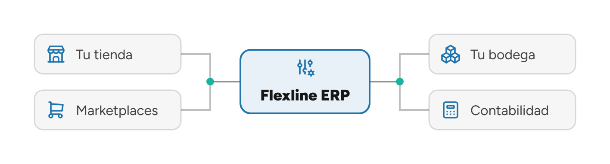

<picture>
  <source media="(prefers-color-scheme: dark)" srcset="encabezado-oscuro.png">
  
</picture>

# IS-C

**¿Cuántas veces se digita la misma venta en tu empresa?**

En la tienda, en Flexline y otra vez en la planilla de despacho. Cada copia es una oportunidad de
error, y el stock se corrige después, cuando ya se vendió lo que no había.

Integramos Flexline con tu tienda, tu bodega y tu contabilidad, automatizamos lo que hoy se
digita a mano y desarrollamos el software que falta alrededor del ERP.

**[Agenda un diagnóstico de 30 minutos, sin costo →](https://www.is-c.cl/go/agendar/)**

[is-c.cl](https://www.is-c.cl/?utm_source=github&utm_medium=social&utm_campaign=perfil) ·
[Casos](https://www.is-c.cl/casos/?utm_source=github&utm_medium=social&utm_campaign=perfil) ·
[Todos los enlaces](https://www.is-c.cl/go/github/)

## Qué hacemos

| Línea | Qué incluye |
| :-- | :-- |
| **[Flexline ERP](https://www.is-c.cl/soluciones/flexline/?utm_source=github&utm_medium=social&utm_campaign=perfil)** | Integración, automatización, migración y soporte. Pedidos, documentos y conciliaciones que entran solos al ERP. |
| **[Desarrollo a medida](https://www.is-c.cl/soluciones/desarrollo/?utm_source=github&utm_medium=social&utm_campaign=perfil)** | Lo que el ERP no hace: aplicaciones de escritorio, portales web y servicios backend que se integran con lo que ya usas. |
| **[IA aplicada](https://www.is-c.cl/servicios/ia-aplicada/?utm_source=github&utm_medium=social&utm_campaign=perfil)** | IA conectada a tus datos reales (Flexline, catálogo, Search Console), con una persona que aprueba donde corresponde. |
| **[Infraestructura](https://www.is-c.cl/soluciones/infraestructura/?utm_source=github&utm_medium=social&utm_campaign=perfil)** | Servidores cloud y locales, redes entre sedes, respaldos probados y monitoreo. |

## Con qué conectamos Flexline

Shopify · Mercado Libre · Multivende · PrestaShop · WordPress · WMSTek · STG · Envíame ·
Duemint · FollowUp · Flapp — [ver integraciones](https://www.is-c.cl/integraciones/?utm_source=github&utm_medium=social&utm_campaign=perfil)

## Cómo trabajamos

> **Digitar dos veces cuesta más que integrar.** Solo que el costo no aparece en ninguna factura:
> aparece en las horas copiando pedidos, en el stock que se corrige tarde y en el cierre que
> espera una planilla.

- La tecnología tiene que resolver problemas, no crear nuevos. Por eso primero ordenamos el
  proceso y después escribimos el código.
- Todos nuestros repos siguen un mismo estándar: Conventional Commits, GitFlow, releases
  versionados con changelog y reglas comunes para agentes de código.
- El código de cada cliente es privado. Los resultados están en
  [casos](https://www.is-c.cl/casos/?utm_source=github&utm_medium=social&utm_campaign=perfil), sin nombrar al cliente
  salvo que lo apruebe.

## Stack

C# / .NET · SQL Server · TypeScript · Astro · Next.js · Python · Shopify (Liquid) · MCP

## Contacto

[contacto@is-c.cl](mailto:contacto@is-c.cl) ·
[LinkedIn](https://www.linkedin.com/company/73458754) ·
[Instagram](https://www.instagram.com/integrasoftc/)
